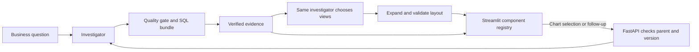

# Analytical response layouts

Start the local analyst with `.\start-analyst.ps1`. Click **Start new session**. For example, ask “Compare failed payment attempts by bank. Let me click a bank to investigate it. Compare 2026-10-01 inclusive to 2026-10-15 exclusive versus 2026-10-15 inclusive to 2026-10-29 exclusive in Asia/Kolkata.”

The same investigator selects an analytical request, executes its registered SQL bundle, receives a catalog of the verified results, and calls `publish_answer` with ordered view IDs. Each ID identifies a legal component and its data binding for this particular result. For example, `drill_bar.banks.failed_attempts` selects an interactive bank failure chart. The server expands those choices into the versioned block specification below. The catalog includes dimensions, measures, row counts and potential drill-down fields. The model can request an empty list. A simple count question can put the counts directly in the headline.

The Streamlit page polls the existing investigation endpoint. While the model plans the layout, the API can return an independently verified finding from the completed SQL receipt. The block list becomes visible once publication completes. Clarification, cancellation and stale authorization clear previous output. **Measured findings and interpretation** and **SQL, quality and provenance** expose the analytical text, definitions, SQL, bound parameters and evidence checksum.

## Version 1 contract

For 24-hour order conversion, the published answer shows paid orders, eligible orders and the conversion rate for each creation window. A two-row summary accompanies the selected views. Text-only layouts show the same figures in sentences. The answer identifies the largest percentage-point decline among bank and payment method pairs with eligible orders in both periods, including ties. Open **SQL, quality and provenance** to load the executed SQL, parameters and supporting rows.



The authenticated `GET /ui/schema` endpoint returns the JSON Schema generated from the Pydantic contract. The investigation response carries the validated specification in `dashboard`. The following example illustrates the shape. An actual response contains the ID assigned to its evidence.

```json
{
  "version": "1",
  "evidence_id": "example-evidence-id",
  "blocks": [
    {"kind": "bar", "source": "banks", "measure": "failed_attempts", "section": "Breakdown", "drilldown": true},
    {"kind": "table", "source": "failures", "section": "Breakdown"}
  ]
}
```

A result reference consists of the envelope’s immutable evidence ID and the block’s source name. For example, `banks` binds to a period-by-bank result from that investigation. Blocks never carry replacement values. The server and frontend use the same trusted projections and validators.

An explicit text-only request removes visual choices from the publication tool. A request to click a category makes an eligible category bar interactive. A drill-down keeps its selected measure in the child headline, so clicking a failed-attempt count continues with failed-attempt counts.

| Kind | Required binding and meaning |
| --- | --- |
| `kpi` | One overall measure and an explicit `baseline` or `comparison` period. |
| `comparison` | The same overall measure for both periods, shown side by side with the underlying counts for rates. |
| `line`, `area` | Daily observations in date order, with separate period series. Area requires an additive measure. Missing dates interrupt the line. |
| `bar` | A measure on a registered dimension, grouped by period when appropriate. An eligible bank, method or merchant bar can carry a drill-down. |
| `pie` | An additive measure across a complete category partition in one period, with at most eight categories. Zero totals produce an unavailable-share message. |
| `table` | The rows and fields from the named result, optionally restricted to one period. |
| `insight` | A trusted explanation of the overall comparison or measured within-segment contribution. |

The optional `section` field groups adjacent blocks under a registered heading. Block order sets prominence. The optional `headline_measure` selects the overall measure for a verified opening sentence. Model-provided prose, URLs, markup, numeric overrides and arbitrary encodings are outside the grammar. The `fallback` flag records a host-selected text fallback.

Registered attempt measures are `rate`, `attempts`, `successes` and `failed_attempts`. Lifecycle measurements expose their own `rate`, `numerator` and `denominator`. The displayed definition specifies the unit, including gross paise for amount-based settlement. Raw counts are summed before a rate is calculated. The bank failure count is exactly attempts minus successes. Rate axes span zero to one.

| Result | Evidence and scope |
| --- | --- |
| `overall`, `daily`, `segments`, `failures` | Verified period totals, daily counts, bank/method segments and recorded failure labels. Availability depends on the registered metric. |
| `banks`, `methods` | Verified rollups of counts by dimension and period. Lifecycle bank rates use summed numerators and denominators. |
| `contributions` | Verified joint bank/method decomposition when the two populations support it. Mix and within effects are fractions of the overall rate change. |
| `daily_summary` | Minimum, median and maximum daily success rates and number of observed days in each period. Each observed day has one vote in this distribution. |
| `merchant_categories`, `merchants` | An optional verified aggregation of attempt counts, requested through the analysis tool’s `detail` parameter. Each partition reconciles to the period totals. |
| `transactions` | Up to 50 latest matching attempts across both windows, ordered by timestamp descending and attempt ID for ties. The full filtered population supplies the metric denominator. |

## Interactions and limits

A bar click sends the parent investigation version plus block and row indexes. The API resolves the row against the current authorized layout, obtains the filter value from evidence and runs a child investigation. It preserves the parent metric, dates, cutoff and existing filters. Under **Filters, dates and comparisons**, select one action at a time. The filter accepts observed banks, methods and merchant IDs. Date controls accept inclusive local calendar dates and submit half-open windows. Attempt-success investigations also support merchant and transaction breakdowns.

**Ask follow-up** sends a natural-language question with the parent’s request, result inventory and verified answer. When it selects the identical registered request, the host reauthorizes the parent evidence and records a child reference to the same snapshot. This costs zero additional fixture SQL. Changed requests run through the ordinary quality, scope and SQL gates. The **Show chart data as tables** toggle displays the rows already associated with each chart.

The validator enforces six blocks, 400 chart points per block, eight pie slices and 2,000 rows per table. Empty selections show an empty state. A zero denominator displays as unavailable. Invalid view selections can be repaired within the existing two-repair investigation allowance. A malformed layout or failed visualization can leave a verified text answer. A data quality block publishes diagnostics only. Session invalidation and invalid evidence still prevent publication.

To add a source, verify its SQL rows or deterministic derivation first, register its dimension, measures and permitted filter in `app/ui_specs/results.py`, and expose it in the typed source vocabulary. To add a visual, extend `app/ui_specs/models.py`, `validate.py` and the registry in `app/frontend/blocks.py`. Historical saved dashboards are read on demand. Replaying a saved layout requires current session authorization.

## Verification

The scoped tests exercise daily trends, bank failures, merchant categories, decline attribution, individual attempts, and a text-only answer. The deterministic integration tests use real restricted PostgreSQL and the Streamlit renderer. The live opt-in uses the configured NVIDIA model. The six-question acceptance run uses the populated `lifecycle_v1` selection and the two October windows above.

```powershell
$analystTestTemp = Join-Path (Resolve-Path .local/analyst/test-temp) ([guid]::NewGuid().ToString('N'))
.\.local\analyst\venv\Scripts\python.exe -m pytest tests/analyst/test_generative_ui.py -q -p no:cacheprovider --basetemp $analystTestTemp

$env:ANALYST_LIVE_UI='1'
.\.local\analyst\venv\Scripts\python.exe -m pytest tests/analyst/test_generative_ui.py -k real_provider_layout -q -p no:cacheprovider
Remove-Item Env:ANALYST_LIVE_UI
```

For the desktop chart-click and mobile session-resume journey, use the private-port browser test described in the [operator guide](analyst-usage.md).
