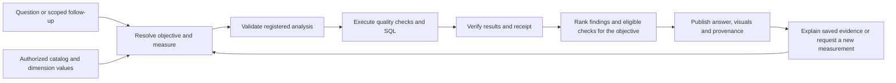

# Payment performance analysis from question to next action

## Goal Capsule

A business user can ask about payment performance, understand what happened and where, inspect the evidence, and choose a specific next step. The analyst should give a different answer when the business question changes and when the underlying records change. Delivery ends when those two properties hold through the live product across the supported payment metric families.

## Product Contract

### Problem frame

Today, the investigator can select a registered analysis, execute restricted PostgreSQL queries, and publish charts with SQL provenance. The last part of the journey loses information. The recommendation for a successful attempt analysis is a fixed sentence. Lifecycle results and data-quality blocks each have their own fixed sentence. Even the ranking in the attempt narrative always looks for the largest increase in a bank/method/reason count. A user asking about the most common reason, a worsening rate, or the main contributor to an overall change can receive the same advice. The publication and recovery paths also build narrative in several places. See `app/evidence/render_claims.py`, `app/agent/tools.py`, `app/agent/checkpoints.py`, and `app/api/session.py`.

### Requirements

| Stage | What the business user should get | What establishes it |
| --- | --- | --- |
| R1. Ask a question | A direct answer to the requested task, including a count, comparison, trend, explanation, or next step. A contextual follow-up inherits the parent question's scope. | Resolve the user's objective as well as the financial measure. Ask one focused question when a missing choice would change the answer. |
| R2. Identify data, measures, and dimensions | The selected dataset, relevant tables, metric, denominator, comparison dates and timezone, filters, and any lifecycle cutoff. | Resolve capabilities and dimension values from the authorized catalog and selected dataset. Surface an unavailable measure or dimension before attempting analysis. |
| R3. Plan and validate | A compact description of what will be compared and how, available with the result. | Bind the registered request, then validate grain, eligible cohort, compatible dimensions, date boundaries and query policy before execution. |
| R4. Execute | Results computed on the supplied database under the current authorization, with SQL, bound parameters and a receipt. | Apply the existing metric-scoped quality checks and execution budgets. A failed or incomplete measurement has an explicit status. |
| R5. Compare and explain | Show magnitude and direction, relevant segments, an appropriate visual when helpful, and plausible drivers with supporting evidence. | Rank at the grain the question requests. Reconcile additive contributions to the overall movement when supported. Show ties, coverage gaps, and limits that affect interpretation. |
| R6. Return an actionable answer | A direct answer followed by evidence, material caveats and prioritized next steps. “What should I do about this?” continues the same finding. | Every suggested check identifies what to inspect, why it matters here, and how the result changes the next decision. State whether the analyst can run it or the operator needs another source. |

### How recommendations should behave

| Business question or evidence | What determines the recommendation | Example of the next decision |
| --- | --- | --- |
| What accounts for most failures? | Aggregate the requested failure reason across the selected population. Rank comparison-period counts, with share of all failures in that scope. | Investigate the highest-volume reason and the segment contributing most to it, when verified. |
| What got worse? | Rank comparable rates on a stated denominator. For a reason-specific failure rate, divide its count by eligible attempts in that same segment and period. Also show exposure and absolute counts. | Check a worsening segment even when overall success improved. Surface small denominators so the user can judge the priority. |
| Why did overall success change? | Use reconciled traffic-mix and within-segment contributions from one complete partition. | If method performance held steady and traffic shifted, examine the shift in traffic. If a segment deteriorated, examine its recorded outcomes. |
| Where are orders or retries being lost? | Use the selected order cohort, observation cutoff and maturity rule. Distinguish first-attempt success, retry uptake, recovery among all initial failures, and recovery among retried orders. | Check whether initially failed orders received a retry or whether retried orders remained unpaid, according to the measured stage. Request a second measure when the first cannot distinguish those explanations. |
| What settlement exposure remains? | Compute due minus completed at the cutoff using the requested unit, obligations or gross amount. | Identify the segment with the outstanding count or amount. A segment leading on count can differ from the one leading on value. |
| Does bank health help explain this? | Check aligned five-minute observations and their coverage. A period summary supports a period comparison. An event-level association requires evidence at event and bucket grain. | Investigate coincident signals when observed. With missing telemetry, check coverage first and name the operational source needed to test the hypothesis. |
| Are the data sufficient to act? | Use the actual blocking rule, denominator, missing detail, or lack of a worsening signal. | Identify a verifiable data correction or scope check, or explain why monitoring the measured outcome is appropriate. A blocked result offers diagnostic guidance only. |

A comparison can legitimately produce one next step, several distinct checks, or no performance intervention. Each quantitative statement must trace to verified rows or a reproducible calculation. A human check should name the evidence to obtain and what it would distinguish. The analyst must describe an external log inspection as proposed work, never as an observation already made.

### Scope

The first delivery covers the existing supplied PostgreSQL datasets and registered payment metrics. Dataset selection remains administrative. The analyst discovers relevant tables and measures within that selection. Connecting a new database engine, automatically changing scenarios, changing payment routing, and retrieving external operational logs are separate product decisions. Preserve the original datasets and evaluator ground truths.

## Planning Contract

### High-level technical design

- KTD1. Record the measurement contract and the business objective independently. Changing from “most failures” to “fastest worsening” can change the ranking while using identical measured rows. Include the requested ranking grain, period and unit. If the user asks “by impact,” clarify only when plausible interpretations would produce materially different answers.
- KTD2. Extend the existing trusted publication path. Derive eligible findings and checks from the verified evidence. The model can select from supported choices. The host verifies the selected item, ranking, denominator, referenced rows, arithmetic and scope, and renders the prose. The fallback uses the same verified candidates. Dataset-specific bank names, dates, counts and threshold-based incident narratives belong outside the runtime logic.
- KTD3. Persist the selected objective and finding/action references with the versioned publication, bound to its evidence ID. Use one projection for API, UI, history and checkpoint restore. Keep previously saved evidence and its original SQL verifiable. Older publications may display their existing answer and offer an explicit new analysis.
- KTD4. The follow-up route distinguishes three outcomes. An explanation of evidence already measured uses the parent snapshot. A supported new measurement uses a child investigation with fresh authorization, an explicit scope change if requested, and the appropriate budget. An external or unsupported check names the missing source or joint breakdown. A suggested check becomes runnable only when its registered command supports the specific scope and grain.

## Implementation Units

### U1. Carry the question through to a validated analysis request

Delivers R1–R4. Use the existing catalog, tool definitions, request types, query policy and executor. Add a compact record of the business objective and the accepted analysis scope. Expose the resolved measure, grain, cohort, dates, dimensions and filters in provenance. Keep the structured plan automatic for an unambiguous question. Use runtime bank resolution and the selected catalog's actual capabilities. A metric unavailable in the selected schema gets a specific explanation. Relevant areas include `app/context/catalog.py`, `app/agent/graph.py`, `app/agent/tools.py`, `app/contracts.py`, and `app/query/policy.py`.

Resolve merchant membership against the selected schema's merchant dimension and validate payment methods against the supported vocabulary for that dataset. Prefer the method dimension where present. For schemas without one, use their registered method contract. A valid entity with zero in-window events must still resolve.

Verify in `tests/analyst/test_agent_flow.py`, `test_catalog.py`, `test_query_policy.py` and `test_windows.py` under the same directory. Cases include a direct count, a rate comparison, an ambiguous recovery denominator, an unavailable settlement metric in an attempt-only schema, an unfamiliar stored bank ID, a valid merchant with zero attempts versus an unknown merchant, an unsupported payment method, and a follow-up whose parent already supplies dates and denominator. Invalid or ambiguous requests must stop before analytical SQL.

### U2. Derive comparable findings and rank them for the objective

Depends on U1. Delivers R5 and the evidence for R6. Start with attempt success and failure labels, then cover order, retry, settlement and health using their metric contracts. Calculate unrounded rankings, return exact ties, use counts to weight aggregate rates, and display the eligible populations. Rank a segment's own deterioration separately from its contribution to the total. Treat incomplete partitions and zero denominators explicitly. Reuse `app/analytics/contributions.py`, `app/analytics/lifecycle.py`, `app/ui_specs/results.py` and `app/evidence/verify.py`. A cause or effect estimate needs evidence beyond a label or correlation.

Verify with `tests/analyst/test_contributions.py`, `test_claims.py`, `test_lifecycle.py` and `test_health.py`. Construct a case where the largest failure count, largest increase in failure rate, and largest contribution to the overall change select different winners. Include ties, a reason split across banks, appearing/disappearing segments, empty windows, amount versus count rankings, and missing health observations.

### U3. Publish recommendations that explain the next decision

Depends on U2. Delivers R5–R6. For each eligible finding, associate a scoped check, the evidence that prioritizes it, and what different check results would imply. Present the most relevant check first. Suppress duplicate advice from overlapping partitions. Keep a simple count answer concise. For a quality block, state the failing rule and the next verification. For an unavailable association or external trace, identify the missing evidence. A daily attempt total and a period-level failure count cannot establish daily timeouts. Use the existing verified result catalog, view validation and trusted rendering. Keep API and UI on the same publication, including the text-only fallback. Relevant areas include `app/agent/tools.py`, `app/evidence/render_claims.py`, `app/ui_specs/validate.py`, and `app/frontend/renderers.py`.

Verify in `tests/analyst/test_claims.py`, `test_evidence.py`, `test_generative_ui.py` and `test_frontend.py`. Reverse the direction of a measured change and require the advice to change. Reject a mismatched evidence reference or unsupported daily breakdown. Cover a blocked dataset, an improvement with one worsening label, neutral findings, and a request for text only. Check chart totals and the units and denominators of every cited number.

### U4. Make the next step work in conversation and after reopening

Depends on U3. Delivers R1 and R6. Carry the parent finding, objective, scope, and verified evidence ID into “why?” and “what steps should I take?” Reuse the existing follow-up, replay, and saved-session paths. A change in denominator, dates, cutoff or required detail triggers the corresponding clarification or new registered analysis. Only offer actions the current result, scope and remaining allowance permit. A stale action refreshes the result for review and leaves execution to the user's current selection. Show diagnostic advice on a blocked result directly. Relevant areas include `app/api/session.py`, `app/agent/checkpoints.py`, `app/agent/hypotheses.py`, and `app/frontend/main.py`.

Verify in `tests/analyst/test_followups.py`, `test_checkpoint_replay.py`, `test_session_recovery.py`, and `test_ui_journey.py`. Test the same follow-up in chat and after a restart. An explanation of existing evidence spends zero new analytical SQL statements. A new breakdown receives its own receipt. A stale version, exhausted adaptive budget, or fully filtered segment must never launch an ineligible action. Legacy saved sessions still open.

### U5. Verify the whole journey on questions the implementation has not seen

Depends on U1–U4. Deliver all six requirements through the public API and the browser. Extend the independent evaluators in `scripts/evaluate_analyst.py` and `scripts/evaluate_lifecycle.py` and the journeys in `tests/analyst/test_durable_browser.py` and `tests/analyst/test_ui_journey.py`. Keep evaluator expectations outside the model context. Record the question, resolved request, result status, evidence ID, relevant SQL and parameters, chart values, ranked finding, proposed action and follow-up outcome. Publish the validation scope alongside results.

## Verification Contract

| Acceptance case | Required outcome |
| --- | --- |
| Largest failure source versus largest deterioration on the same rows | Two questions select their independently calculated winners, show the relevant denominators, and recommend checks appropriate to each. |
| Overall decline, stable segment rates | The verified mix contribution explains the movement. The next step examines the changing distribution of attempts. |
| Success improves while one label worsens | The answer reports both directions. It quantifies the label's rate per eligible attempt and proposes a focused check. |
| A different bank, label, or outcome distribution in a disposable fixture | Ranking, rationale, chart, and next action follow the changed data. The production CSVs and saved benchmark answers retain their original hashes. |
| Orders, retries, settlements and health | Exercise every registered lifecycle metric. Independently verify cohort maturity, both recovery denominators, due count versus amount, and health coverage as applicable. A recommendation refers only to the measured stage. |
| Data or execution prevents a conclusion | Dirty rows yield rule-specific guidance. A missing denominator yields an unavailable rate. A failed or interrupted execution identifies what was verified. No unsupported driver or operational intervention is published. |
| Follow-up, replay and stale scope | A contextual recommendation works with the same parent after reopening. Changed scope executes through restricted SQL. The API and browser agree on evidence, findings and allowable actions. |

Run the scoped `tests/analyst` suite with the project's analyst environment. Use the existing opt-in browser and live-model evaluator paths on native PostgreSQL. Exercise administrative scenario switches in a disposable cluster and use distinct report paths. Add an output-path option to the lifecycle evaluator before running these cases so its historical acceptance reports are preserved. Record which checks used the real hosted model and which used a model double. Retain the existing read-only grants, query/time/token budgets and protected-source fingerprint checks.

## Definition of Done

A business user can complete the six-stage journey, inspect the query behind a claim, and act on or question a recommendation without reconstructing scope. An independent evaluator can reproduce the answer and ranking and identify what evidence would change the recommendation. The comparison, mix-shift, lifecycle and insufficient-evidence cases all pass through their intended public surfaces, including a follow-up. Report live-provider, browser and controlled-fixture results separately. These are implementation acceptance criteria.
