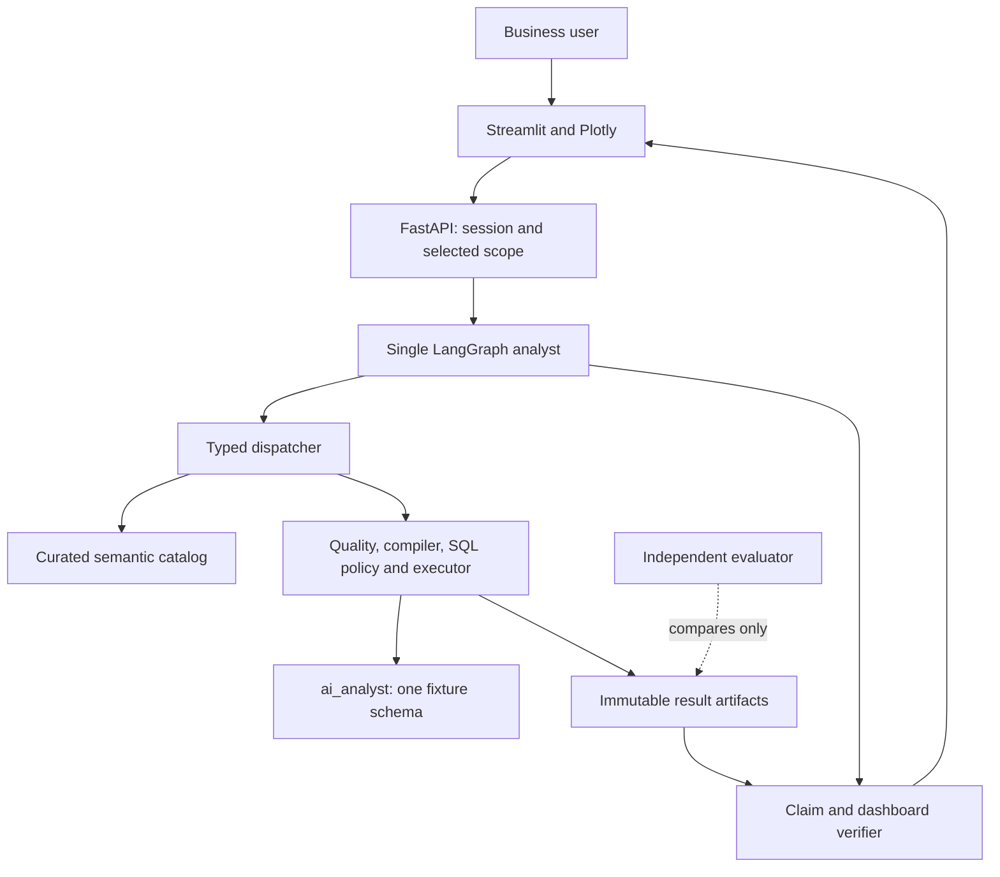
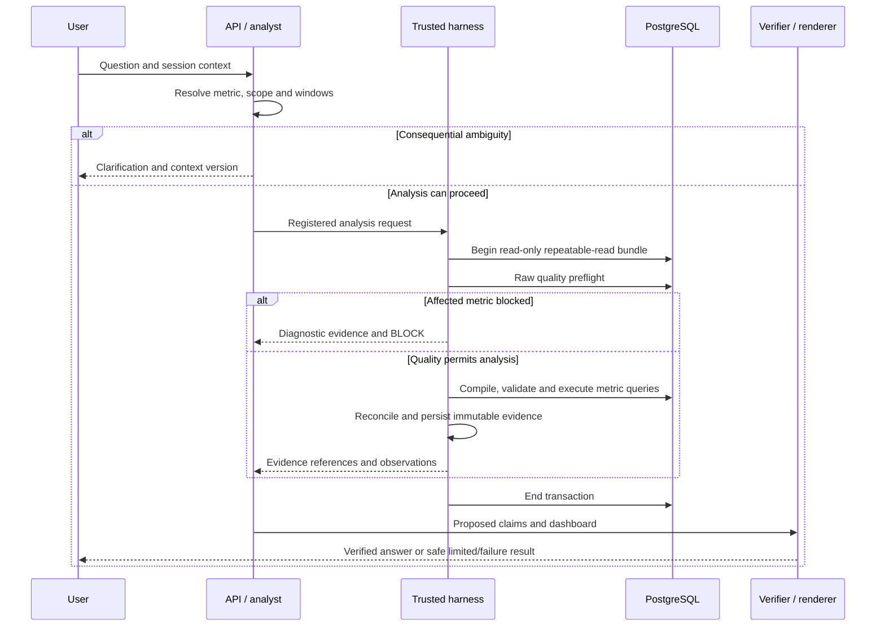
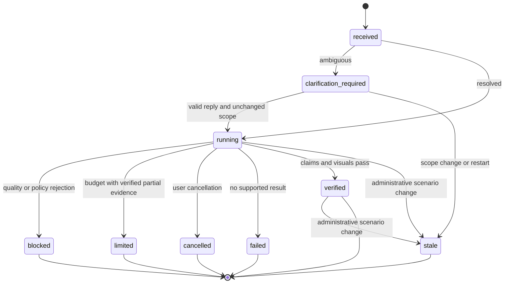

# Enterprise AI Business Analyst - Plan

## Goal Capsule

**Objective:** A business user can ask about payment performance and receive an accurate, useful explanation supported by executed queries, visible evidence, and an honest account of what the data cannot establish.

**Means:** One LLM analyst operates through a deterministic analytical harness and a validated Streamlit/Plotly interface (KTD1–KTD9).

**Authority:** Current user instructions and `AGENTS.md` govern preservation and operational boundaries. The v4 design supplies product scope and the selected application stack. This plan resolves implementation details; existing evaluation artifacts remain independent numerical authorities for their own definitions.

**Execution profile:** Build U1–U7 as the first complete application delivery. U8–U9 describe subsequent v1 increments and do not delay the demo. This workspace has no Git repository; delivery means local files and reproducible evidence, with no implied commits, PRs, or publishing.

**Stop conditions:** The demo is done only at G1 in the Verification Contract. The broader first-analyst acceptance is G2. Do not mark either passed from dataset reports, model doubles, screenshots alone, or partially completed checks.

**Handoff:** A subsequent implementation run owns code, dependency installation, live validation, and documentation updates. Provider/model configuration is required before the live-model portion of U5 and G1; deterministic foundation work can begin independently.

---

## Product Contract

### Summary

Implement the v4 design as a complete question-to-answer demo first, followed by lifecycle and durable investigation capabilities. The demo includes approved attempt metrics, period comparison, bank/method segmentation, mix-versus-rate attribution, visible SQL, verified charts, and safe failure. Native PostgreSQL and the existing fixtures remain the data source.

### Problem Frame

The project has validated payment datasets and a restricted database role, but no analyst application. A user cannot yet ask a business question and inspect the calculations behind an answer. Database correctness alone does not establish that generated explanations use the right population, distinguish mix from deterioration, or refuse unreliable conclusions.

### Requirements

**Question answering and evidence**

- R1. Answer natural-language payment questions through real SQL execution over at least two related actual tables, beginning with `payments` and `banks` (origin §§1, 4, 15).
- R2. Resolve metric, denominator, filters, selected dataset, and explicit comparison windows before calculation; clarify consequential ambiguity (origin §§4.3, 5).
- R3. Report overall and segmented counts/rates, distinguish mix effects from within-segment changes, and verify a claimed decline before explaining it (origin §§7, 11).
- R4. Publish material numerical facts only when they resolve to executed evidence, with visible SQL, parameters, population, windows, denominator, and caveats (origin §§9, 15).
- R5. Separate measured facts, hypotheses, and recommendations; never present correlation or recorded failure labels as causal proof (origin §§7–9).

**Safety and data preservation**

- R6. Enforce one administratively selected fixture per analysis through application policy and PostgreSQL privileges; the analyst cannot select or combine fixtures (`AGENTS.md`, origin §§3, 6).
- R7. Keep model capabilities limited to typed analytical tools and answer-free selected-schema context; exclude host tools, credentials, evaluator artifacts, and administrative code (`AGENTS.md`, origin §§3–6).
- R8. Detect relevant quality failures from rows and block affected certified metrics without silently repairing, deduplicating, or filtering away defects (origin §8 and `AGENTS.md`).
- R9. Preserve all existing CSVs, original evaluation artifacts, source-snapshot baselines, native cluster, and Codex npm files; do not introduce Docker, WSL, or another persistent database (`AGENTS.md`).
- R10. Bound execution and expose clarification, blocked, limited, cancelled, and failed outcomes without fabricated completion (origin §§5, 13).

**Presentation and acceptance**

- R11. Render approved evidence-backed components and technical evidence through a real UI; model output cannot execute frontend code (origin §10).
- R12. Evaluate the application independently, starting with Phase 1 A, B, and dirty-data behavior, then Phase 2 and Phase 3; keep each acceptance claim separate (`AGENTS.md`, origin §§14–17).
- R13. In v1, support lifecycle metrics with correct grains/cutoffs and telemetry-limited reasoning (origin §§4, 7).
- R14. In v1, preserve scoped investigation state across restarts and support reauthorized follow-ups and chart drill-down (origin §§5, 9–10, 13).

### Actors and flows

- A1. Business user: asks, clarifies, inspects evidence, and follows up within the selected dataset.
- A2. Local operator: starts services, supplies private configuration, and changes scenario through existing administrative tooling.
- A3. Evaluator: runs independent benchmarks and retains expected answers outside the analyst runtime.

- F1. A1 asks → API binds scope → analyst resolves intent → harness checks quality and executes a comparison → verifier approves claims → UI displays evidence. Covers R1–R8, R10–R11.
- F2. Ambiguous question → one focused clarification → reply carries the investigation/context version → API reauthorizes → F1 resumes. Covers R2, R6, R10.
- F3. Dirty or forbidden request → structured diagnostic or denial → affected business answer stays blocked → UI explains the limitation. Covers R6–R8, R10–R11.
- F4. A2 changes scenario → active contexts/results become stale → new analysis starts under fresh grants. Covers R6, R14.

### Acceptance examples

- AE1. For Scenario A and the two October fortnights, the answer localizes deterioration to the correct bank/method and ties the explanation to measured failure labels. Covers R1–R5, R12.
- AE2. For Scenario B, the answer explains aggregate deterioration through method mix without claiming method reliability worsened. Covers R3, R5, R12.
- AE3. For dirty Scenario A, all three seeded defect classes are discovered from rows and certified period metrics are blocked. Covers R8, R12.
- AE4. For lifecycle baseline, a question asserting an unsupported overall decline receives the measured comparison and a correction of the premise. Covers R2–R5.
- AE5. “Why did success rate fall last week?” on these October fixtures requires metric/window resolution rather than substitution of fixture dates. Covers R2.
- AE6. An evidence ID from another investigation or an old selected schema cannot be retrieved or rendered under current authorization. Covers R6–R7, R11.

### Scope boundaries

U1–U7 deliver the mandatory v4 §15.1 demo plus the stronger Phase 1 A/B/dirty acceptance from `AGENTS.md`. Phase 2 single-schema attempt analyses are included in the demo evaluation sequence. Phase 3 attempt/bank analysis is mandatory; lifecycle expansion belongs to U8.

The demo uses a localhost-only, single-operator identity. It does not claim enterprise authentication, tenant RBAC, or production deployment. There is one globally selected scenario for the shared database role, not independent per-user scenario selection.

### Deferred to Follow-Up Work

U8 adds lifecycle and health tools. U9 adds PostgreSQL evidence/checkpoints, adaptive cross-bundle investigations, typed drill-down, and source-definition conflict handling. Guarded exploratory SQL remains a later v1 extension after its own policy/adversarial evaluation; it is not necessary for registered metrics. Optional caching waits for measured need and version/scope-safe invalidation.

Full dynamic layouts, React migration, enterprise identity/connectors, external audit integration, and production-scale evaluation remain deferred as in v4. Phases 4–7 dataset work requires separate user authorization.

**Considered and not built:** a vector database has no demonstrated context-search need; a universal SQL engine would widen the demo attack surface without improving its registered analyses; OS-account sandbox provisioning is outside this local application milestone. Reconsider these only when scale, supported questions, or deployment threat model changes. The capability boundary in R7 is still mandatory.

---

## Planning Contract

### Evidence baseline

Source inspection establishes the following starting points; live application behavior remains unverified.

| Existing artifact | What it establishes | Implementation consequence |
|---|---|---|
| `scripts/postgres_analytics.py`, `scripts/postgres_phase1.py` | Native administration; scenario selection terminates sessions and replaces grants globally | Keep administration outside application runtime imports |
| `database/phase3/tables.sql`, `scripts/lifecycle_schema.py` | Eight lifecycle tables; text columns; keys/local checks | Build adapters against actual fields; no invented retries table |
| `docs/phase3-data-dictionary.md` | Attempt/order/settlement grains, time basis, cutoff and bucket meanings | Use as a clean semantic source with explicit versioning |
| `database/phase1/quality.sql` | Existing duplicate, timestamp-presence and orphan diagnostics | Extend application checks; this query is not a complete runtime quality gate |
| `evaluation/phase1/`, `evaluation/phase2/`, `evaluation/phase3/` | Independent SQL, answers and hand fixtures | Evaluator-only dependencies; never runtime retrieval material |
| `reports/postgres_analytics_last_run.json`, `reports/postgres_analytics_validation.json` | Saved six-scenario validation and restricted-role checks passed | U1 must verify current connectivity/metadata without reimporting |
| `reports/phase3_test_results.json` | Saved seven lifecycle and fourteen database tests passed | Existing coverage does not certify analyst behavior |
| `evaluation/phase3/validation_report.json` | Dataset gate passed; analyst gate pending | Keep original report unchanged; write new application reports |

There is no application package or framework scaffold. The npm files belong to Codex. No `STRATEGY.md`, `CONCEPTS.md`, or existing application conventions were found in the root inventory.

### Physical and semantic mapping

| Relation | Actual grain | Safe analytical use |
|---|---|---|
| `payments` | Completed attempt, keyed by `attempt_id` | Attempt success by `attempted_at`; lifecycle adds order, sequence, completion and ingestion fields |
| `banks`, `merchants` | One dimension row per ID | Many-to-one joins checked for preservation of attempt counts |
| `orders` | One purchase intention | Aggregate attempts to order grain before conversion joins |
| `payment_methods`, `failure_reasons` | Reference keys | Success has blank failure reason; joining reasons must not discard successes |
| `settlements` | One obligation per successful attempt in this fixture | Due-by-cutoff completion; count and amount measures remain distinct |
| `bank_health` | Bank × method × five-minute interval | Join on bank, method and containing half-open bucket |

All business columns remain text, including empty strings. Retry is `attempt_number > 1`, not another relation. Lifecycle order conversion requires 24 hours of observation and success completed within 24 hours. Preserve the successful retry on October 29: whole-store totals and October 1–28 attempt totals intentionally differ.

### Key technical decisions

- KTD1. **Use the supplied Python stack in an isolated application environment.** FastAPI, Pydantic v2, LangGraph, SQLGlot, Streamlit, Plotly, Psycopg 3, and pytest implement R1–R14. Resolve and lock stable compatible releases during U1; existing standard-library scripts stay usable. Pydantic v1 is unsupported on Python 3.14, so do not use its compatibility namespace. [Pydantic 2.12](https://pydantic.dev/articles/pydantic-v2-12-release), [FastAPI migration guidance](https://fastapi.tiangolo.com/how-to/migrate-from-pydantic-v1-to-pydantic-v2/).

- KTD2. **Build a new restricted query module.** Existing `psql`/`query_json` helpers default to administrator credentials and import evaluator modules. The runtime executor connects only as `ai_analyst`, has no administrator fallback, and accepts registered metric requests rather than model SQL. SQLGlot parses the PostgreSQL dialect and enforces a fail-closed AST allowlist; database permissions independently enforce R6. Filter values use driver binding, and identifiers come from trusted catalog entries. [SQLGlot limitations](https://sqlglot.com/sqlglot.html), [Psycopg parameters](https://www.psycopg.org/psycopg3/docs/basic/params.html).

- KTD3. **Make scope server-owned and keep the model tool surface small.** The server injects subject, selected schema, investigation ID, context version and budgets after request validation. Model arguments cannot override them. Demo tools provide semantic/schema context, atomic metric analysis, quality evidence, contribution calculation and evidence lookup. The same services back UI and model requests; scenario switching is never exposed. Package runtime assets through an explicit inclusion list and test actual model payloads for evaluator leakage. This satisfies R6–R7 without claiming an OS security sandbox against the Windows account owner.

  Bind each demo session to an original restricted authorization connection, kept open without an idle transaction. Verify it with a server round-trip on that original connection before serving evidence and before publishing an answer; a cached client-side connection flag is insufficient. Administrative selection terminates it even when switching A→B→A between user requests. Any disconnect permanently invalidates that session's investigations; a replacement connection creates a new session generation and cannot revive old contexts. Current schema/grants alone are insufficient proof of continuity. U9 replaces this restart-limited continuity mechanism with a durable administrative selection generation.

- KTD4. **Execute each demo analytical bundle in one read-only repeatable-read transaction.** Raw-text quality checks run before casts/joins, followed by overall, segment, daily and failure-reason results and post-query reconciliation. Material results in one answer must share that bundle; do not merge separately acquired snapshots. The demo obtains all diagnostic evidence in one bundle, then closes the transaction before model narration. A data-changing follow-up creates a new bundle and replaces the active answer. Snapshot IDs are provenance, not restartable snapshots. [PostgreSQL isolation](https://www.postgresql.org/docs/18/sql-set-transaction.html).

- KTD5. **Persist demo evidence locally; stage PostgreSQL persistence in U9.** Trusted code writes bounded JSON artifacts atomically under `.local/analyst/evidence/`, keyed by server-assigned IDs with checksums and a unique investigation/step key. The model never receives path access. LangGraph uses in-memory state for the demo; restart invalidates unfinished work and old browser sessions, while evidence files remain for operator/evaluator inspection. This is an explicit staging of v4 §§9, 12–13, not a claim of durable checkpoint delivery. U9 creates a private metadata schema and separate writer in the same database, without changing fixture read privileges. [LangGraph persistence](https://docs.langchain.com/oss/python/langgraph/persistence).

- KTD6. **Version symmetric decomposition independently.** Use v4 §7.1's midpoint-weight formula in deterministic arithmetic, with fraction units internally and percentage points at presentation. Segment keys must be mutually exclusive, exhaustive and consistent across periods. With a zero population in either period or an appearing/disappearing segment, report decomposition unavailable and show supported counts/rates; do not invent the missing rate. Require reconciliation within `1e-10` in fraction units before rounding. The legacy Phase 1 reference uses a different weighting convention; preserve it and add independent application-level cases where weights and rates both change.

- KTD7. **Verify before publishing, including free text.** Material facts use typed references to result cells or registered deterministic derivations. Recompute rates, differences, rankings, units and denominator compatibility. Render numerical factual sentences from validated claims so free-form prose cannot bypass verification. Model hypotheses/recommendations use separate labeled fields with evidence references; unsupported causal proof and unverified factual clauses are rejected or omitted through a bounded correction path. A dashboard is published only after its claims and field mappings pass. Full richer claim schemas can grow later; the publication boundary cannot be deferred.

- KTD8. **Use a local single-operator API boundary.** Bind API and UI to loopback, issue a private per-run session capability, and validate requests and investigation ownership server-side. Keep the model provider key and restricted DB credential in trusted service configuration, absent from browser payloads, model context, and logs. Fail startup if configured for non-loopback exposure without a real identity implementation. This is a local demo access contract, not a production authentication claim.

- KTD9. **Use a fixed component registry for the demo.** KPI, bar/line chart, table, quality warning and evidence panel consume validated result references. Limits cover components, rows and bytes; no code, SQL, arbitrary HTML or unsupported transformations enter a dashboard spec. Presentation-only changes reuse current compatible evidence. U9 routes chart selections through typed reauthorized filters. Chart interaction needs browser proof because Streamlit AppTest does not natively support chart elements. [Plotly selection API](https://docs.streamlit.io/develop/api-reference/charts/st.plotly_chart), [AppTest limitations](https://docs.streamlit.io/develop/concepts/app-testing/cheat-sheet).

- KTD10. **Use bounded, explicit failure handling.** Initial configurable limits are 10 model-facing tool calls, 12 SQL statements including quality checks, 2 repair attempts total, 120 seconds per investigation, 2,000 returned rows and 1 MiB per result artifact, and 6 dashboard components. Apply a 10-second local statement timeout without changing the existing 15-second role default or 30-second idle-transaction default. Include failed attempts in budgets. Token and monetary ceilings are configured against the selected provider before live acceptance. Authorization/quality failures are non-retryable; cancellation and timeout roll back and discard the connection if cleanup is uncertain. Only already verified separable findings may appear in a limited response.

### High-level technical design







The trusted dispatcher, query policy, quality checks and publication verifier are the decision points in F1/F3. Every terminal result carries its status; a visible old chart must be cleared or explicitly invalidated when its active scope becomes stale.

### Assumptions and prerequisites

- The live demo runs locally for one operator. Exposing it to other machines requires a separate authentication/deployment decision.
- Provider/model remains configurable because no selection was supplied. Use one provider adapter initially, not a multi-provider routing framework. Missing configuration blocks real-model validation, not deterministic implementation.
- Exact dependency versions, native Windows wheels and provider tool/structured-output behavior are U1/U5 execution checks. Official support ranges do not certify this machine's dependency closure. [Psycopg installation support](https://www.psycopg.org/psycopg3/docs/basic/install.html).
- PostgreSQL remains native Windows in `payments_analytics`. Start/status/validate may be needed during implementation, but application startup never runs setup or ingestion.
- The 48-hour allocation is a planning budget, not a delivery guarantee. Cut U8/U9 depth before weakening safety or substituting model stubs at G1.

### Delivery sequence and budget

| Work | Indicative hours | Exit before moving on |
|---|---:|---|
| U1: environment, audit and contracts | 0–6 | Real selected-schema read and clean catalog |
| U2–U4: trusted analysis and publication boundary | 6–24 | Known-answer query plus dirty-data block |
| U5: real model and API | 24–32 | Natural-language question reaches verified evidence |
| U6: UI | 32–40 | Real result chart/table and visible SQL |
| U7: evaluation and operational proof | 40–48 | G1 evidence, with failures/skips explicit |

No competing architecture requires a bake-off: the source fixes the stack and single-agent/harness boundary. Persistence staging and compiled metrics follow its explicit demo/v1 split. Implementing two alternative applications would spend the challenge budget without resolving an unsettled product choice.

---

## Output Structure

Proposed additions; none are claimed to exist yet. Per-unit file lists own the actual scope.

```text
pyproject.toml
requirements-analyst.lock
app/
  contracts.py
  config.py
  api/
  agent/
  context/
  semantic/
  query/
  quality/
  analytics/
  evidence/
  ui_specs/
  frontend/
  observability/
configs/analyst.example.yaml
tests/analyst/
evaluation/analyst/
scripts/audit_analyst_schema.py
scripts/evaluate_analyst.py
docs/analyst-usage.md
reports/analyst/
```

`evaluation/analyst/` extends the existing evaluator convention instead of adding a competing `eval/` hierarchy. Runtime package/build configuration excludes it and all original evaluation directories. Proposed operational files under `.local/analyst/` remain ignored.

---

## Implementation Units

### U1. Establish the native application foundation and clean contracts

**Goal:** Provide a runnable dependency set, audited physical mapping, and safe typed inputs for R1–R2, R6–R7, R9.

**Dependencies:** None. Live database availability is an execution prerequisite for the audit portion.

**Files:** Create `pyproject.toml`, `requirements-analyst.lock`, `app/config.py`, `app/contracts.py`, `app/semantic/metrics.yaml`, `app/semantic/joins.yaml`, `app/semantic/scenarios.yaml`, `app/context/catalog.py`, `configs/analyst.example.yaml`, `scripts/audit_analyst_schema.py`, `tests/analyst/test_catalog.py`, `tests/analyst/test_runtime_boundary.py`. Write audit output under `reports/analyst/`; preserve existing dependency files.

**Approach:**

1. Resolve the KTD1 dependency set in a separate native environment and record versions. Define test collection to target `tests/analyst/` explicitly.
2. Audit current selected-schema names, column representations, keys, indexes, row counts, timestamp/status validity and source identity. Compare live findings with saved reports without rebuilding fixtures.
3. Produce separate developer audit and sanitized runtime catalog artifacts. Raw audit counts, profile seed and evaluator pointers do not belong in model retrieval.
4. Define shared request, scope, evidence, claim, quality, budget and dashboard envelopes once in `app/contracts.py`; later units extend these contracts instead of creating competing shapes.
5. Extract answer-free metric definitions for all approved grains, exposing only implemented metric IDs. Define schema adapters for the three-table fixtures and lifecycle structure.

**Patterns:** `scripts/lifecycle_schema.py`, `database/phase3/tables.sql`, `docs/phase3-data-dictionary.md`; sanitize earlier dictionaries rather than copying them wholesale.

**Test scenarios:**

- A three-table fixture maps attempt/bank joins, while lifecycle maps eight real tables and derives retries from attempts.
- Catalog requests return only the current scenario and implemented metric IDs.
- Unknown metric/dimension/filter combinations and model-supplied schema overrides fail typed validation.
- Runtime package and serialized model context contain no evaluator import, expected answer, profile, administrator secret, or host-tool registration.
- Installed libraries import and a minimal API, graph, restricted DB read, and Plotly render work on native Windows.

**Verification:** A saved audit matches the current database and the dependency smoke check records exact versions. Catalog tests catch accidental disclosure and mapping errors; they do not prove query correctness or OS-level isolation.

### U2. Enforce restricted execution and metric-scoped quality

**Goal:** Make the only analytical execution path satisfy R6–R10 before business metrics become reachable.

**Dependencies:** U1.

**Files:** Create `app/query/executor.py`, `app/query/policy.py`, `app/quality/checks.py`, `app/quality/policy.py`, `tests/analyst/test_query_policy.py`, `tests/analyst/test_quality.py`, `tests/analyst/test_executor_integration.py`.

**Approach:**

1. Implement KTD2's dedicated connection path and KTD4's transaction bundle, using server-owned selected-schema metadata.
2. Check duplicate IDs/occurrences, missing or malformed timestamps, status/reason validity, required numeric representations, and dimension references before unsafe casts or joins. Scope checks to the metric dependencies while treating unknown timestamp membership conservatively.
3. Return rule ID, affected metric/scope, observed defect count, PASS/WARN/BLOCK, and diagnostic query evidence. Dirty period metrics remain BLOCK; diagnostics remain inspectable.
4. Apply KTD10 budgets and cancellation; ensure rollback and clean connection disposal on every failure.

**Patterns:** Existing database privileges and denial probes in `scripts/test_postgres_phase1.py`; existing quality queries are evidence for rule intent, not runtime imports.

**Test scenarios:**

- Covers AE3. Real dirty rows reveal 20 duplicate occurrences, 10 missing timestamps and 10 orphan merchants before joins or filters hide them; no certified rate is returned.
- Malformed text timestamps or amounts fail quality without conversion errors leaking raw internals.
- DML, DDL, multiple statements, data-modifying CTEs, SELECT INTO, locking clauses, cross-schema relations, catalog access, unknown functions, file/program operations and role changes are rejected.
- Disabling a read-only default cannot grant forbidden database access; direct restricted-role probes verify privileges independently of the parser.
- Adversarial filter strings remain bound values, not identifiers or SQL fragments.
- Timeout/cancellation rolls back; the next clean request works without inheriting transaction state.

**Verification:** Both policy tests and real restricted-role integration tests pass. Unit tests prove dispatch/policy decisions; only live DB tests establish actual role isolation and cleanup.

### U3. Compile attempt analyses and reconciled contributions

**Goal:** Supply deterministic comparison, segmentation and attribution for R1–R3, R5.

**Dependencies:** U1, U2.

**Files:** Create `app/query/compiler.py`, `app/analytics/attempts.py`, `app/analytics/contributions.py`, `tests/analyst/test_compiler.py`, `tests/analyst/test_contributions.py`, `tests/analyst/test_attempts_integration.py`.

**Approach:**

1. Compile registered attempt metrics independently from semantic definitions; do not import evaluator SQL.
2. Execute one KTD4 bundle containing overall comparison, exhaustive bank×method segments, requested trend and failure-label counts. Join actual bank dimensions and validate row/grain preservation.
3. Calculate KTD6 attribution from returned counts. Derive bank or method summaries from the same joint partition, avoiding double-counting overlapping breakdowns.
4. Preserve half-open, timezone-aware windows and emit unavailable rates for zero denominators. An out-of-range window is not evidence of 0% success.

**Patterns:** Existing metric definitions and table contracts; independent expected answers are used only by tests.

**Test scenarios:**

- Covers AE1–AE2. A identifies the affected joint segment; B has zero within-method change and an aggregate mix explanation.
- A hand-calculated case where both shares and rates change matches the symmetric formula and differs appropriately from the legacy convention.
- New/disappearing segments, overlapping group definitions and zero denominators produce the specified unavailable/error outcomes rather than fabricated contributions.
- Percentage-point and relative-percent changes are distinct; reconciliation uses unrounded fraction values.
- Covers AE4. Lifecycle fortnight comparison does not force a decline narrative.
- The October 29 retry is excluded by the October 1–28 attempt window and retained in whole-store attempt totals; eligible order-conversion coverage belongs to U8.

**Verification:** Independent evaluator comparisons match counts exactly and rates within documented tolerances. Pure arithmetic tests catch attribution errors; live joins and date-boundary tests prove database semantics.

### U4. Persist evidence and verify every publication

**Goal:** Enforce R4–R5 and R11 through a durable result record and minimal complete verifier.

**Dependencies:** U1–U3.

**Files:** Create `app/evidence/store.py`, `app/evidence/verify.py`, `app/evidence/render_claims.py`, `app/ui_specs/models.py`, `app/ui_specs/validate.py`, `tests/analyst/test_evidence.py`, `tests/analyst/test_claims.py`, `tests/analyst/test_dashboard_specs.py`.

**Approach:**

1. Implement KTD5 evidence writes with SQL/hash, bound parameters, selected scope, semantic version, snapshot/bundle identity, cutoff, counts, quality records, timestamps and result checksum.
2. Bind evidence retrieval to current subject/investigation/scope, without accepting filesystem paths from callers.
3. Implement KTD7 claim references and deterministic numerical rendering; reject unsupported values, rankings, units, causal claims and incompatible source bundles.
4. Validate KTD9 component field mappings and aggregations against approved evidence before returning a publishable response.

**Test scenarios:**

- Repeating a step returns the same evidence identity; interrupted artifact publication leaves no apparently complete corrupt artifact.
- Covers AE6. Guessed IDs, old scopes and another investigation's artifacts fail access checks.
- Fabricated percentages, sign/denominator changes, changed rankings and unsupported numerical text cannot reach a factual answer.
- Unknown columns/components, executable content and wrong units fail dashboard validation.
- A quality BLOCK cannot be overridden by a valid-looking claim or chart.
- A chart failure preserves raw evidence and produces a safe table/evidence fallback only from verified fields.

**Verification:** Deliberately invalid claims/specifications fail before publication; valid executed artifacts render unchanged. These tests prove the trusted publication boundary, not arbitrary natural-language causal understanding.

### U5. Connect the single analyst to the API and bounded state machine

**Goal:** Complete F1–F3 with real natural language while enforcing R2, R6–R7, R10.

**Dependencies:** U1–U4. A configured real provider/model is required for live validation; no key is needed for deterministic contract tests.

**Files:** Create `app/api/main.py`, `app/api/session.py`, `app/agent/graph.py`, `app/agent/model.py`, `app/agent/tools.py`, `app/agent/prompts.py`, `app/observability/events.py`, `tests/analyst/test_agent_flow.py`, `tests/analyst/test_api.py`, `tests/analyst/test_live_model.py`.

**Approach:**

1. Implement the explicit graph/state diagram with direct, diagnostic and clarification routes. The agent chooses registered analyses, inspects tool results and revises claims within the allocated budget.
2. Integrate one structured-tool-capable provider behind `model.py`; keep provider-specific parsing out of semantic and analytical modules.
3. Implement KTD3/KTD8 protected scope and session ownership. Recheck grants and original authorization-connection continuity before stored-evidence access and publication; failed continuity invalidates the session permanently rather than silently reconnecting it.
4. Implement KTD10 stopping behavior and structured audit events with safe errors, tool/query runtimes, budget use, evidence IDs and verifier outcomes.

**Test scenarios:**

- A real model interprets an explicit comparison question, calls analytical tools and answers from newly executed results.
- Covers AE5/F2. Ambiguity returns a focused clarification without spending query budget; a valid versioned reply resumes, and stale replies fail safely.
- A request to switch schema, read a secret/evaluator file, invoke Python or ignore quality cannot reach such a tool.
- Database labels containing instructions remain data in model observations.
- Administrative selection change invalidates prior state and prevents old evidence reuse. Test A→B→A with no intervening application request and confirm that even identical final grants cannot revive the old session.
- Provider absence, rate limiting, bad structured output, timeout and cancellation produce appropriate terminal statuses; retry never resets budgets or substitutes a mock answer.
- Covers AE4. The model accepts a measured no-decline finding and does not invent an outage.

**Verification:** API/graph tests cover routing and enforcement. Live model traces prove actual natural-language/tool integration; deterministic doubles never count toward G1.

### U6. Deliver the evidence-backed UI journey

**Goal:** Let A1 ask, clarify and inspect real results under R1, R4–R5, R10–R11.

**Dependencies:** U4, U5.

**Files:** Create `app/frontend/main.py`, `app/frontend/renderers.py`, `app/frontend/api_client.py`, `tests/analyst/test_frontend.py`, `tests/analyst/test_ui_journey.py`.

**Approach:**

1. Display selected dataset, explicit windows and metric before the answer. Keep scenario changes out of the business UI.
2. Render direct answer, verified facts, supported contributors, hypotheses, next actions, chart/table and expandable SQL/quality evidence through KTD9.
3. Show clarification and safe failure as normal result states. Clear active results when session/scope becomes stale.
4. Support presentation changes against existing evidence; reserve chart-driven data changes for U9.

**Test scenarios:**

- The real UI sends a question to the API and displays chart points/table cells that exactly match the executed evidence.
- SQL, parameters, filters, denominator and windows are visible and match the rendered result.
- Dirty-data BLOCK is visibly different from an empty successful analysis; no stale KPI remains certified.
- A presentation-only bar/table switch makes no additional SQL call.
- Chart labels with markup render safely; unknown spec fields cannot execute code.
- Clarification, provider failure and cancellation remain usable without showing unverified figures.

**Verification:** AppTest covers supported controls and messages; figure-data checks cover mappings; a real browser journey proves rendering and API/DB integration. UI tests alone do not establish numerical oracle correctness.

### U7. Prove the demo independently and document operation

**Goal:** Establish R9/R12 and G1 with evidence, preserving honest pending status for later gates.

**Dependencies:** U1–U6.

**Files:** Create `scripts/evaluate_analyst.py`, `evaluation/analyst/benchmark_questions.json`, `evaluation/analyst/decomposition_cases.json`, `evaluation/analyst/acceptance_manifest.json`, `tests/analyst/test_evaluation.py`, `docs/analyst-usage.md`; update `README.md` and `AGENTS.md` only to reflect verified progress; write results under `reports/analyst/`.

**Approach:**

1. Map app outputs to the existing independent answers by metric, windows and definition, keeping oracle loading strictly in the evaluator process.
2. Author new independently calculated decomposition/policy cases only where old contracts do not cover v4 behavior. Never rewrite original ground truths to fit the app.
3. Run scenarios sequentially through administrative selection, fresh clients and clean investigations. Restore `lifecycle_v1` afterward, including on failure.
4. Record exact versions, provider/model ID, query/evidence IDs, pass/fail/skipped reasons, timings, visible UI proof and protected-source hashes. Never include credentials or secret payloads.
5. Document local startup/shutdown, configuration, scenario administration, limits, clarification, unavailable features and restart behavior.

**Test scenarios:**

- Phase 1 A, B and dirty questions map to the appropriate independent checks and cannot pass by reading expected answers in the runtime.
- Phase 2 baseline and incident are evaluated separately; paired counterfactual answers requiring both schemas are refused by the analyst and remain evaluator-only.
- Phase 3 attempt/bank questions execute against lifecycle tables and use lifecycle truth.
- Missing provider/browser/live DB evidence leaves the corresponding gate pending or failed, never passed from mocks or saved dataset reports.
- A failed evaluation restores scenario selection and leaves all protected source hashes unchanged.

**Verification:** A3 can reproduce G1 from the documented environment and inspect SQL/results behind every asserted success. Harness tests prove report integrity; the live acceptance manifest proves the application journey.

### U8. Add lifecycle and scoped bank-health analysis after the demo

**Goal:** Meet R13 and complete G2 without changing the fixture definitions.

**Dependencies:** U7 and a passing G1.

**Files:** Extend `app/semantic/metrics.yaml`, `app/semantic/joins.yaml`, `app/agent/tools.py`, `app/quality/checks.py`, `evaluation/analyst/benchmark_questions.json`; create `app/analytics/lifecycle.py`, `app/analytics/health.py`, `tests/analyst/test_lifecycle.py`, `tests/analyst/test_lifecycle_integration.py`, `tests/analyst/test_health.py`.

**Approach:** Implement conversion, first-attempt success, retry uptake/recovery with explicitly distinct denominators, due settlement count/amount completion, and aligned bank health. Register metric-scoped quality dependencies. Pre-aggregate order outcomes before joins and preserve cutoff/maturity contracts.

**Patterns:** `docs/phase3-data-dictionary.md` and lifecycle field contract; evaluator hand fixture and existing oracle sections stay private.

**Test scenarios:**

- Multiple attempts for an order do not multiply the order denominator.
- The October 29 success is correctly included in eligible 24-hour order conversion while excluded from October 1–28 attempt metrics.
- The evaluator hand fixture distinguishes immature orders, not-yet-due obligations and overdue/pending due obligations.
- Retry recovery among all first-failure orders differs correctly from recovery among retried orders.
- Missing/late telemetry limits health claims without blocking otherwise valid attempt rates.
- Health bucket boundaries and bank/method keys preserve cardinality; correlation remains a hypothesis.

**Verification:** Independent Phase 3 sections and the hand fixture agree at each metric's grain. Hand tests prove boundary arithmetic; real queries prove joins and scope isolation. G2 stays pending until these pass.

### U9. Add durable investigation state and reauthorized interaction

**Goal:** Meet R14 and the remaining target-v1 investigation behavior after analytical correctness is demonstrated.

**Dependencies:** U7; lifecycle investigations also require U8.

**Files:** Create `database/analyst/metadata.sql`, `scripts/setup_analyst_metadata.py`, `app/evidence/postgres_store.py`, `app/agent/checkpoints.py`, `app/agent/hypotheses.py`, `app/analytics/source_conflicts.py`, `tests/analyst/test_persistence_integration.py`, `tests/analyst/test_followups.py`, `tests/analyst/test_source_conflicts.py`; extend `scripts/postgres_phase1.py`, `scripts/test_postgres_phase1.py`, API, graph, UI specs, frontend and operational docs.

**Approach:**

1. Add one private application metadata schema in `payments_analytics` with a separately scoped writer. Administrative setup owns DDL; runtime writer has no fixture rights. The six business schemas remain unchanged; metadata is not a seventh fixture. Deny it to `ai_analyst` and exclude it from business catalogs.
2. Configure the pinned LangGraph saver against that schema and use JSON-compatible typed state. Persist stable step IDs before side effects; evidence uniqueness must survive replay after crashes. [Checkpoint fault tolerance](https://docs.langchain.com/oss/python/langgraph/fault-tolerance).
3. Add hypothesis states, bounded adaptive tests and reauthorized follow-ups. Extend administrative selection with a durable monotonic generation and bind checkpoint/evidence authorization to it. Advance it before enabling clients after every selection, including selecting the same schema; failure leaves clients unable to resume old state. For cross-bundle analysis, separately track an administrative import/version epoch and invalidate active work during fixture replacement. If provenance cannot establish consistency, recompute the needed comparison in one bundle; a transaction snapshot ID is not a persistent data version.
4. Route chart selections to the same typed filter/API path as chat. Presentation-only updates continue to reuse evidence.
5. Reconcile conflicting measurements only within authorized scope by comparing metric contracts and provenance. If unresolved, show both definitions and limitations without selecting an unsupported winner.

**Test scenarios:**

- Crash before/after evidence commit and checkpoint replay creates one published step result and retains budget accounting.
- Writer cannot query fixtures; analyst cannot read/write metadata; broadening search_path does not change either result.
- Old subject/scope/version cannot resume or fetch evidence after administrative changes or restart; A→B→A and same-schema reselection advance the durable selection generation.
- A bank selection inherits explicit windows and metric, is reauthorized, executes fresh evidence and updates charts/narrative consistently.
- Concurrent attempts to resume the same context cannot publish incompatible versions.
- Conflicting definitions are explained or reconciled by rules, never resolved by choosing the preferred number.

**Verification:** Real PostgreSQL persistence/privilege and browser-interaction tests pass. Inspect saver setup/search-path behavior for the locked version before enabling restart recovery. No production identity or general-purpose exploratory SQL claim follows from this unit.

---

## Verification Contract

### Gates and required evidence

| Gate | Required proof | What does not establish it |
|---|---|---|
| G0: foundation | Native dependency smoke, current read-only schema audit, clean runtime assets, unchanged protected inputs | Historical reports alone |
| G1: complete demo | Every v4 §15.1 check; real UI/model/API/SQL journey using two related lifecycle tables; Phase 1 A/B/dirty and Phase 2 single-schema comparisons; visible safe failure | Unit doubles, simulated SQL, static charts or only database tests |
| G2: first analyst breadth | G1 plus Phase 3 attempt, order conversion, retries and settlement acceptance under independent truth | Only attempt metrics on lifecycle tables |
| G3: target v1 | G2 plus durable replay, adaptive bounded investigation, context-preserving drill-down and conflict behavior | Local evidence files or in-memory state alone |

Application reports are new artifacts under `reports/analyst/`. Do not edit original dataset reports to declare application acceptance. Report each gate independently with the actual run identity and missing evidence.

### Independent numerical checks

Compare counts and integer paise exactly. Compare unrounded rates and decomposition in fraction units using KTD6's tolerance; verify display rounding separately. Compare only like-defined metrics and time windows. Additional benchmark facts must be independently calculated, not copied from the runtime implementation.

Each published benchmark answer must include the question, schema, metric version, numerator/denominator, filters, timestamps/timezone, SQL/parameters, result checksum, quality status and claimed derivations. A benchmark passes only if the structured facts and the visible narrative/visual agree.

The developer/evaluator-only anchors are Scenario A's 98%→96.2%, Scenario B's 96.4%→91.6% with stable method rates, and dirty A's three defect groups. These values belong in independent evaluator assertions, never runtime prompts, semantic examples, compiler branches or narration templates. Phase 2/3 values come from their saved answer contracts, not transplanted Phase 1 numbers.

### Test isolation and preservation

Use explicit `tests/analyst/` collection for new tests. Existing focused coverage is `scripts/test_postgres_phase1.py` and `scripts/test_phase3.py`; do not use broad unittest discovery. The existing live DB suite includes repeat import and rollback, so reserve it for changes to database administration/privileges or the explicit compatibility gate, not every UI edit.

Do not run generators, Phase 1 generation tests or reproducibility modes during this implementation. Check saved protected-file snapshots without replacing them; additionally fingerprint all 23 final CSVs and original evaluator inputs before/after the app work. Use evaluator hand cases as read-only inputs to disposable test mechanisms, never as edits to the main fixtures or another persistent database.

Application integration runs are sequential for scenario selection because `ai_analyst` grants are global. Restore `lifecycle_v1`, reconnect, and verify eight visible lifecycle tables after evaluation. The evaluator may hold admin authority; the analyst runtime cannot import or invoke it.

### Source design traceability

| v4 sections | Owning work |
|---|---|
| §§1–3: outcome, scope, trust | R1–R12; KTD2–KTD9; U1–U7 |
| §4: audit, semantics, ambiguity, conflict | U1, U3, U5; conflict extension U9 |
| §5: single-agent state and investigation | U5; durable/adaptive extension U9 |
| §6: tools, safety, optional cache | U2–U5; exploratory SQL/cache explicitly deferred |
| §7: attribution and lifecycle | U3, U8; KTD6 |
| §§8–9: quality, uncertainty, evidence | U2, U4, U5; persistence extension U9 |
| §§10–11: UI and walkthrough | U6, U7; drill-down U9 |
| §§12–13: stack, budgets, resilience | KTD1, KTD5, KTD10; U1, U5, U9 |
| §§14–17 and Appendix A: delivery/acceptance | U7; G0–G3; U8/U9 staged after demo |
| Appendix B: integration dependencies | U1 audit, U5 model configuration and research-backed KTDs |

---

## Risks and Operational Notes

| Risk | Decision and evidence required |
|---|---|
| Full architecture exceeds 48 hours | Deliver U1–U7 first; never remove quality/authorization/verification to meet the clock |
| Python 3.14 dependency incompatibility | U1 native installation smoke; record exact blocker before selecting another native interpreter |
| No provider/model configuration | Keep U5 live checks and G1 pending; allow deterministic units to progress |
| Dirty text disappears through filtering or joins | U2 raw preflight and independent defect assertions precede metric work |
| Comparison combines different snapshots | KTD4 single-bundle answer; U9 requires data-version evidence before cross-bundle synthesis |
| Scenario changes while a browser retains evidence | U5 authorization refresh and U6 stale-result clearing; U9 resume checks |
| Generic claims escape structured validation | KTD7 constrained factual rendering and rejection tests include visible text, not only JSON |
| Native host credentials are reachable by the Windows owner | Trust the operator; enforce typed model capabilities and clean packaging without claiming OS isolation |
| New metadata storage accidentally widens analyst access | U9 separate writer and reciprocal denial tests; keep fixture inventory distinct |

Install/start instructions belong in `docs/analyst-usage.md`, including the preserved native database controller, required private settings, selected schema, observation cutoff, application limits and exact validation entry points. README should link the application only after a runnable path exists. AGENTS updates must distinguish code written, checks passed, checks skipped and remaining gates.

### Deferred / Open Questions

- **Live-integration prerequisite:** supply a structured-tool-capable provider/model, credentials and approved usage ceilings before U5 live validation. No provider or model has been selected by this plan.
- **Execution-time verification:** exact native package pins, database reachability, query runtimes and browser automation availability are established during U1/U6, not presumed from documentation.
- **U9 prerequisite:** confirm the pinned PostgreSQL saver can initialize and operate solely in the private metadata schema. If it cannot, adapt the trusted persistence boundary before enabling durable recovery; never widen `ai_analyst` permissions.

These do not require rewriting the product design. A missing prerequisite blocks its dependent live gate and must remain visible in the implementation report.

---

## Definition of Done

The first delivery is complete when U1–U7 meet their verification outcomes and G1 passes with real model, UI, database and independent benchmark evidence. G2 and G3 remain separately pending until U8 and U9 supply their required proof.

The deliverable includes runnable native application files, a locked dependency set, clean semantic assets, explicit operational instructions and a reproducible acceptance report. It leaves all protected data and original truths unchanged, restores the administrative scenario after evaluation, and removes abandoned experimental application code. No unsupported benchmark, sandbox, production-security, persistence or causal claim appears in the final documentation.
